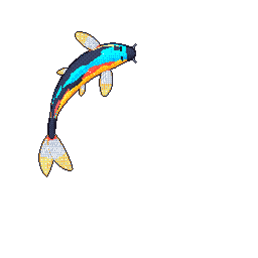

<h1 align="center">Hi, I'm Vaibhav 👋</h1>

  Senior Software Engineer at <a href="https://www.postman.com">Postman</a> · previously HackerRank &amp; BrowserStack

  
  
  

  
   
  🎏 Redrawn every night from my GitHub activity by <a href="https://github.com/yalongwastaken/git-koi">git-koi</a>

### 🧭 What I work on

- 🔐 **Identity & auth at scale**: authentication and user management at Postman; before that, HackerRank's authorization service
- ⚙️ **Distributed, event-driven systems**: high-throughput services, orchestration, reliability and observability
- 🤖 **AI agents & MCP tooling**: agentic debugging harnesses and MCP servers like [sqlpad-mcp](https://github.com/VAIBHAV7500/sqlpad-mcp)

🎌 Off the keyboard: anime, manga and travel.

### 🛠️ Tech stack

**Languages** 

**Data & messaging** 

**Infrastructure** 

### 📌 Featured projects

| Project | What it is | Built with |
|---|---|---|
| [anime_web_app](https://github.com/VAIBHAV7500/anime_web_app)  | A full OTT-style anime streaming platform | React · Node.js · MySQL · Redis · Docker · AWS |
| [lets_binge](https://github.com/VAIBHAV7500/lets_binge)  | Watch videos in sync with friends, with live chat | React · Firestore |
| [sqlpad-mcp](https://github.com/VAIBHAV7500/sqlpad-mcp) | MCP server that lets AI agents explore schemas and run SQL on SQLPad | TypeScript |
